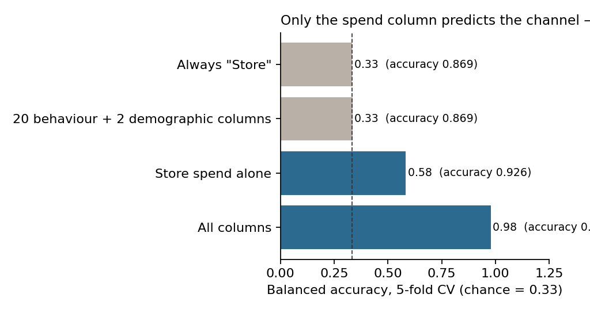

# Can this data answer "who shops online"? — a synthetic-data audit

**Live page:** [setosfk.github.io/projects/shopping-audit](https://setosfk.github.io/projects/shopping-audit/) · Streamlit app (`app.py`) · Python + R · [Türkçe özet ↓](#türkçe-özet)

A 25-column consumer shopping dataset from Kaggle (11,789 rows: age, income, internet hours, trust and loyalty
scores, spend, and a *Store / Online / Hybrid* preference). The first version of this repo was a course dashboard
that ran tests and classifiers on it. This version asks the question that should come first: **can this data
say anything about shoppers at all?**

## Results

| Check | Result | Against |
|---|---|---|
| Are the 22 numeric columns related? | strongest of 231 pairs: **\|ρ\| = 0.025**; 0 pairs above 0.1 | shuffling every column independently: 0.027 (79.5 % of shuffles are stronger) |
| Income ↔ store spend | **ρ = −0.002** | would be clearly positive for real shoppers |
| Do the 0–10 scores look like random draws? | **13 of 13** uniform (χ² p > 0.01); gender and city tier split in thirds | — |
| Predict the preference from behaviour + demographics | balanced accuracy **0.33**, accuracy 0.869 | always "Store": 0.33 / 0.869 |
| … from store spend alone | balanced accuracy 0.58 | — |
| … from every column | accuracy **99.7 %**; on the full data the classes separate **perfectly** | the label is a linear formula of 8 columns |



**What it means.** The Kaggle author says the data were synthesized, and the data agree: every column is an
independent random draw, and the target is a threshold on a weighted sum of 8 columns (store spend dominates;
touch-and-feel need, tech-savviness, online orders, store visits, payment trust, internet hours and online
availability follow). Clusters, correlations or "drivers" found here describe the generator, not consumers — and
the only strong predictor, spend, is an *outcome* of the channel, so using it is circular. The honest use of this
dataset is practice; the honest result of this project is the audit.

## Run it

```bash
pip install -r requirements.txt
python python/audit.py            # every number above → results/audit.json, docs/models.png, web/data/
Rscript R/audit.R                 # same checks in base R, same folds, parity report
streamlit run app.py              # Python app (Streamlit Community Cloud compatible)
Rscript -e 'shiny::runApp("R")'   # R app
python -m http.server -d web      # static page at localhost:8000
```

**Python ↔ R parity:** the strongest correlation, every effect size and the behaviour-only and spend-only models
agree to 5 decimals on the same folds. With all columns the classes are separable, so the unpenalised likelihood has
no finite optimum; the two optimisers stop at different large coefficients (accuracy 99.65 % vs 99.68 %).

## Read with care

- A negative result: fine for teaching and practice, not for conclusions about consumer behaviour.
- With 11,789 rows every small gap is "significant"; effect sizes are reported, not p-values.
- The April 2026 course version of the app is in the git history (commit `fea44e9`).

Data: Kaggle [sahilgod/consumers-shopping-trends-2026](https://www.kaggle.com/datasets/sahilgod/consumers-shopping-trends-2026), CC0 (public domain). Code: MIT.

---

## Türkçe özet

**Soru:** Bu 25 sütunluk alışveriş veri seti tüketiciler hakkında bir şey söyleyebilir mi?

- **Hayır.** 22 sayısal sütunun hiçbiri bir diğeriyle ilişkili değil (231 çiftin en güçlüsü |ρ| 0,025; tamamen bağımsız sütunlarda beklenen 0,027). Gelir ile mağaza harcaması arasında bile ilişki yok. 13 puan sütununun 13'ü de 0–10 arasında düzgün dağılıyor.
- Davranış ve demografi sütunları alışveriş tercihini **hiç** tahmin etmiyor (dengeli doğruluk 0,33 = şans).
- Tüm sütunlarla doğruluk %99,7: etiket 8 sütunun doğrusal bir formülü. Model tüketiciyi değil, veriyi üreten formülü geri buluyor; en güçlü değişken olan harcama da tercihin sonucu, yani döngüsel.
- Sonuç: veri ders ve pratik için uygun, tüketici davranışı hakkında çıkarım için uygun değil. Bunu göstermek projenin sonucu.
